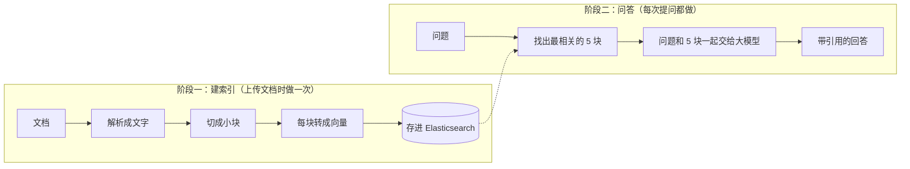
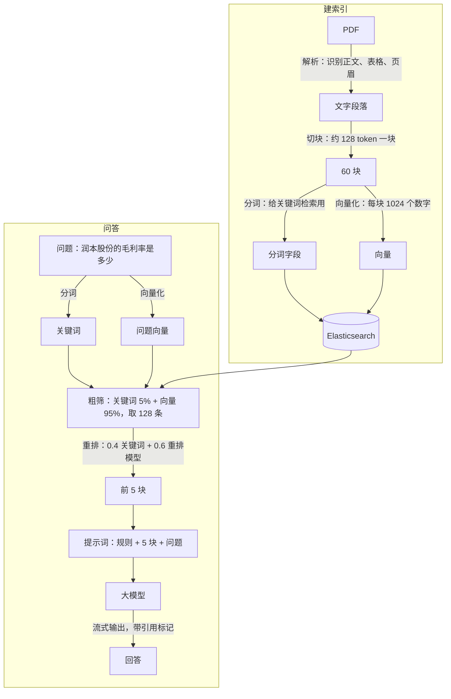

# RAG 入门篇：先搞懂概念，再看代码

> **适合谁：** 第一次接触 RAG，看 [导读](./RAG系统架构导读.md) 和 [代码走读](./RAG系统核心模块深入篇.md) 时被“向量”“召回”“重排”这些词卡住的人。
>
> **读完能做到：** 知道 RAG 每一步在解决什么问题，看到代码时知道它为什么要这样写。
>
> 本篇的例子和数字都来自这个系统的真实运行结果，不是编的。

**推荐阅读顺序：** 入门篇（本篇）→ [导读](./RAG系统架构导读.md) → [代码走读](./RAG系统核心模块深入篇.md) → [实战篇](./RAG实战篇.md)

---

## 1. RAG 要解决什么问题

假设你直接问大模型：“润本股份 2025 年上半年的毛利率是多少？”

大模型大概率答不对：它训练时没见过这份研报。更麻烦的是，它可能**一本正经地编一个数字**。这种现象叫“幻觉”。

**RAG 的思路就像开卷考试：**

1. 先去资料里**翻到相关的那几页**；
2. 把这几页和题目一起交给大模型；
3. 要求它**只根据这几页作答**，并注明答案出自哪一页。

RAG 是 Retrieval-Augmented Generation 的缩写，直译是“检索增强生成”：**先检索，再生成**。

**为什么不把所有资料直接塞给大模型？**

- **装不下。** 大模型一次能读的文字有上限。几份研报还行，几百份文档就远远超了。
- **太贵、太慢。** 费用和耗时基本跟输入长度成正比。
- **找不准。** 资料越长，模型越容易漏看关键的那一句。

所以要先“翻书”，只把最相关的一小部分交给模型。本系统每次只给模型 **5 段**。

---

## 2. RAG 分两个阶段



| 阶段 | 类比 | 本系统里的入口 |
|---|---|---|
| 建索引 | 把一本书拆成卡片，给每张卡片编好目录 | [`ingest_document()`](../backend/app/services/ingestion.py#L102)（在后台 worker 进程里执行） |
| 问答 | 按目录找到相关卡片，照着卡片答题 | [`chat_on_docs()`](../backend/app/api/chat.py#L109) |

**建索引做一次，问答做无数次。** 所以建索引阶段慢一点没关系（一份十几页的研报，从解析到写入大约要十几秒到几十秒；页数多、扫描件会更慢），问答阶段必须快（几秒内开始出字）。本系统把建索引放在单独的 worker 进程里做，上传后立即返回，不会拖慢问答。

---

## 3. 术语表

按在流程里出现的顺序排列，每个词都配了本系统里的例子。

### 建索引阶段

- **文档解析**：把 PDF、Word 等文件变成纯文字。PDF 最难：要识别哪里是正文、哪里是表格、哪里是页眉，还要把一行一行的文字拼回段落。
  - 本系统：[`naive.py` 的 `chunk()`](../backend/app/engine/rag/app/naive.py#L193)，PDF 部分用的是 RAGFlow 的 DeepDoc。
- **块（chunk）**：文档被切成的小段，是检索的**最小单位**。检索时找的是“块”，不是“文档”。
  - 本系统：两份研报一共切成 60 块。
- **token**：大模型计算文字长度的单位。不同模型的算法不同，本系统里 1 个汉字大约是 1.1～1.3 个 token。
  - 本系统：切块的目标长度是 128 token，实际块长度的中位数在 200～250 token 之间。
- **分词**：把一句中文切成一个个词。英文天然有空格，中文没有，所以需要分词器。
  - 本系统：`请问国电电力2023年的营业收入` → `请问 国电电力 2023 年 的 营业 收入`
- **向量（embedding）**：用一串数字表示一段话的“意思”。**意思越接近的两段话，它们的向量越接近。**
  - 本系统：每块转成 **1024 个数字**，比如“润本股份的毛利率是多少”的前 5 个数是 `[0.024, -0.027, 0.042, 0.025, 0.037]`。这些数字单独看没有意义，拿来互相比较才有意义。
- **向量模型**：负责把文字转成向量的模型。
  - 本系统：阿里云百炼的 `qwen3.7-text-embedding`。
- **索引**：存放所有块的地方，相当于数据库里的一张表。
  - 本系统：所有用户共用 Elasticsearch 里的一个索引 `swxy_chunks`，每块都带一个 `kb_id` 字段标明属于谁，检索时只查自己的。

### 问答阶段

- **余弦相似度**：衡量两个向量有多接近的数，越接近 1 越相似。下面是用本系统的向量模型实际算出来的：

  | 句子 A | 句子 B | 相似度 |
  |---|---|---|
  | 太阳能 | 光伏 | **0.63** |
  | 太阳能 | 煤电 | 0.31 |
  | 公司赚钱能力怎么样 | 毛利率和净利率 | **0.50** |
  | 公司赚钱能力怎么样 | 发电量和上网电量 | 0.31 |

  “太阳能”和“光伏”一个字都不重合，向量却认为它们很像。**这就是向量检索的价值：理解意思，而不只是对比字面。**

- **关键词检索（全文检索）**：按字面找，问题里的词在块里出现得越多、越重要，得分越高。传统搜索引擎就是这么做的。
  - 本系统：[`FulltextQueryer.question()`](../backend/app/engine/rag/nlp/query.py#L70) 把问题变成 Elasticsearch 的关键词查询。
- **向量检索（kNN）**：把问题也转成向量，找和它最接近的那些块。kNN 是“k 个最近邻”的意思。
- **混合检索**：关键词检索和向量检索一起用，两边的分数加权合并。
  - 本系统：关键词占 5%，向量占 95%。
- **召回（粗筛）**：从所有块里先快速筛出一批“可能相关”的候选。目标是**宁可多拿，不要漏掉**。
  - 本系统：混合检索取前 128 条。
- **问题改写（query rewrite）**：多轮对话里，用户的追问常常省略主语，比如“那它的净利率呢？”。检索前先结合前面的对话，把它改写成能单独理解的问题。
  - 本系统：“那它的净利率呢？” → “青松科技2025年上半年的净利率是多少？”，见 [`rewrite_question()`](../backend/app/services/conversation.py#L44)。
- **重排（rerank）**：用一个更准、但更慢的模型，对候选逐条重新打分。目标是**把真正相关的排到最前面**。
  - 本系统：阿里云百炼的 `qwen3.7-text-rerank`，最终分 = 0.4 × 关键词分 + 0.6 × 重排分。
- **Top-K**：最终取前几条。
  - 本系统：K = 5。
- **提示词（prompt）**：发给大模型的完整文字，包括规则、参考资料和用户的问题。
  - 本系统：规则在 [`services/chat.py` 第 17 行](../backend/app/services/chat.py#L17) 的 `SYSTEM_PROMPT`。
- **引用**：要求模型在回答里注明每句话出自哪一块，方便用户核对。
  - 本系统：参考内容从 `[0]` 开始编号，模型输出 `##0$$` 这样的标记，前端把它渲染成可点击的角标 `[1]`。
- **流式输出**：模型生成一点就推给浏览器一点，不用等整段写完。本系统用的技术是 SSE（Server-Sent Events，服务器推送事件）。
  - 本系统：[`stream_chat()`](../backend/app/services/chat.py#L95) 每 `yield` 一次就推一条。
- **幻觉**：模型编造参考资料里没有的内容。RAG 能大幅减少幻觉，但不能完全消除。

---

## 4. 几个关键设计的“为什么”

### 4.1 为什么要切块？块多大合适？

检索的单位是块。块的大小是一个取舍：

| 块太大 | 块太小 |
|---|---|
| 一块里混了好几个话题，向量变成“平均意思”，哪个话题都不突出 | 一句话被切断，上下文丢了 |
| 给模型 5 块就占用很长的提示词 | 5 块加起来信息太少，答不全 |
| **结果：找不准** | **结果：答不全** |

一般经验是每块一两百到几百个字。本系统设的是 128 token（约 100 个汉字），但规则是“超过 128 才切”，所以实际中位数在 200～250 token。

**本系统里的反面例子：** 财务报表不切分，一张表就是一块，最长的一块有 **1582 token**。里面有营收、利润、费用、现金流……问哪一项都能沾上边，但哪一项都不突出。

### 4.2 为什么关键词和向量都要用？

两者各有擅长，也各有短板：

| | 关键词检索 | 向量检索 |
|---|---|---|
| 擅长 | **精确的名称、代码、数字**：“603193”、“ROE”、“润本股份” | **换了说法的问题**：“太阳能”能找到“光伏” |
| 短板 | 不认识同义词，“赚钱能力”找不到“毛利率” | 对精确名称不敏感（见下面的例子） |

向量对精确名称不敏感的真实例子：

| 问题 | 块 | 向量相似度 |
|---|---|---|
| 润本股份的毛利率是多少 | （润本）25H1公司毛利率同比+0.4pct至59.0%… | **0.565** |
| 润本股份的毛利率是多少 | （国电）2025年上半年，公司毛利率为16.27%… | 0.486 |
| 润本股份的毛利率是多少 | （免责声明）本报告的版权归本公司所有… | 0.414 |

润本和国电的毛利率只差 0.08。向量知道这两块都在讲毛利率，但分不太清是哪家公司的。这时关键词“润本股份”就能帮上忙。

**本系统的评测结果**（[实战篇第 2 节](./RAG实战篇.md#2-怎么衡量检索效果)）：问题里直接用了原文词汇的，答案 100% 排在第 1 名；换了说法的，只有 57% 排在第 1 名。

### 4.3 为什么要先粗筛再重排？

**重排模型更准，但更慢。** 它要把“问题 + 一块”成对地读一遍再打分，块越多越慢。如果对全库每一块都跑一遍重排，库一大就完全不可行。

所以分两步：

1. **粗筛**：用便宜的方法（向量 + 关键词）从全库里快速拿出 128 条。
2. **重排**：只对这 128 条用贵的方法精确打分。

本系统里重排的效果非常明显。问“润本股份的毛利率是多少”时：

| | 前 5 名里润本的块 | 前 5 名里国电的块 |
|---|---|---|
| 重排失败（只剩关键词分） | 3 | **2（排在第 2、3 名）** |
| 重排正常 | 3 | 2（排在第 4、5 名） |

重排把“润本的财务表”提到了前面，把国电的内容压到了后面。详细数据见 [代码走读 2.5](./RAG系统核心模块深入篇.md#25-重排给候选重新打分)。

### 4.4 为什么文档和问题必须用同一个向量模型？

不同向量模型的数字代表的意思完全不同，就像两张比例尺、坐标原点都不同的地图，拿 A 地图上的坐标去 B 地图上找，找到的是错的地方。

**后果：** 换了向量模型，必须把所有文档**重新入库**，重新算向量（`python manage.py reindex-all`）。本系统的向量字段名里带维度（`q_1024_vec`），换成维度不同的模型时，新旧向量连字段都对不上。

### 4.5 为什么要让模型标引用？

- **能核对。** 用户点开引用，就能看到原文，判断模型有没有说错。
- **约束模型。** 要求“每句话都标来源”，模型就更倾向于照着参考资料说，而不是自由发挥。

### 4.6 解析和切块的质量，决定了检索的上限

检索再厉害，也只能从块里找。如果块本身就是乱的，后面怎么调都没用。本系统现有的 60 块里就有两类典型的“坏块”：

**免责声明，约占 1/4。** 研报末尾的法律声明被完整切成了 15 块左右，比如：

```
本报告的版权归本公司所有，属于非公开资料。本公司对本报告保留一切权利。未经本公司事先书面授权……
```

它们和任何问题都没关系，却占着检索的名额。上面的例子里，它和“润本股份的毛利率”的向量相似度也有 0.41，离真正的答案（0.565）并不远。

**图表块，只剩坐标轴数字。** PDF 里的柱状图被解析成了这样：

```
图1：国电电力营业收入及增速（单位：亿元） 营业收入 同比增速 2500 20% 2000 10% 1500 1000 500 20% 20202021202220232024 24H125H1
```

只有标题有用，数字是坐标轴刻度，不是真实数据。用户问“国电电力营业收入”时，这块可能会被找出来，但模型从里面读不出任何答案。

**经验：** 检索效果不好时，**先看看块长什么样**，再去调参数。查看所有块的命令见 [实战篇 1.4](./RAG实战篇.md#14-第四步看块本身对不对)。

---

## 5. 一张图串起来



图里的每个箭头，在 [代码走读](./RAG系统核心模块深入篇.md) 里都有对应的一节，贴了代码和实测数据。
