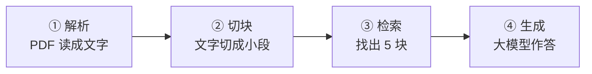
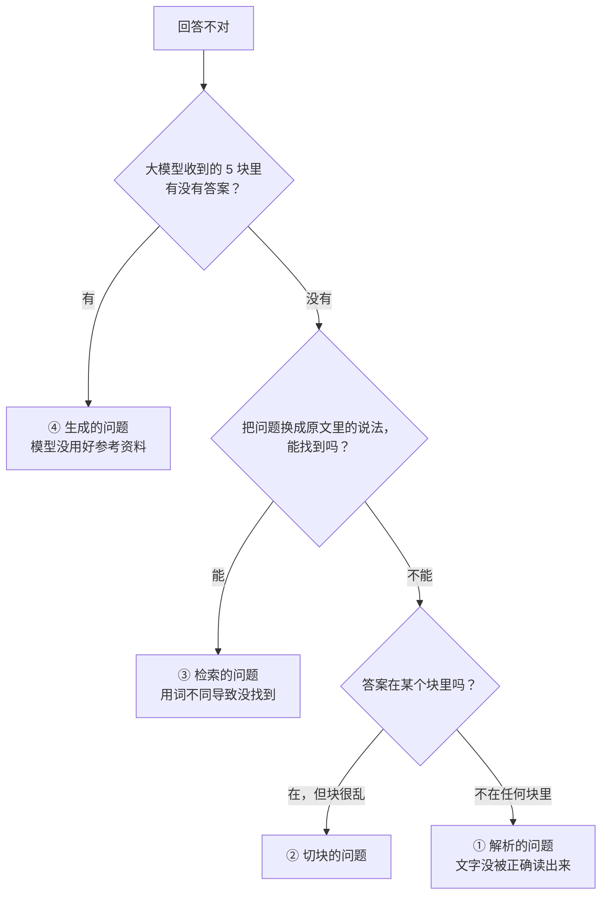

# RAG 实战篇：定位问题、衡量效果、下一步学什么

> 读这篇之前，建议先读 [入门篇](./RAG入门篇.md) 了解基本概念。
>
> 本篇分三部分：
>
> 1. [回答不对时，怎么判断是哪一步出了问题](#1-回答不对时怎么判断是哪一步出了问题)
> 2. [怎么衡量检索效果](#2-怎么衡量检索效果)
> 3. [这个系统还缺什么：学习路线](#3-这个系统还缺什么学习路线)
>
> 所有命令都在宿主机的 `swxy/` 目录下执行，后端容器 `swxy_api` 需要在运行。

---

## 1. 回答不对时，怎么判断是哪一步出了问题

RAG 的回答出错，原因一定在下面四步中的某一步：



**排查要从后往前查**：先看大模型拿到了什么（④），再看检索找没找对（③），再看块本身对不对（②），最后看解析有没有出错（①）。越往后的步骤越容易检查，而且大部分问题在 ③ 和 ④ 就能找到。



### 1.1 第一步：看大模型实际收到了什么

每轮问答保存时，会把**发给大模型的参考内容原样存下来**（`messages` 表的 `documents` 字段），编号和提示词里的 `[0]`、`[1]` 一一对应。先在页面上问一次，然后看最近一条：

```bash
docker exec -w /app swxy_api python -c "
import json, logging; logging.disable(logging.CRITICAL)
from db.database import SessionLocal
from models import Message
m = SessionLocal().query(Message).order_by(Message.created_at.desc()).first()
print('问题:', m.user_question)
print('实际检索的问题:', m.retrieval_query)
for i, d in enumerate(json.loads(m.documents or '[]')):
    print(f'[{i}]', d['document_name'], '|', d['content_with_weight'][:80].replace(chr(10), ' '))
"
```

实测输出（一个用户问“2025年上半年国电电力营业净利润增速怎样？”）：

```
问题: 2025年上半年国电电力营业净利润增速怎样？
实际检索的问题: 2025年上半年国电电力营业净利润增速怎样？
[0] 国电电力.pdf | 国电电力（600795.SH）优于大市25H1扣非归母净利润同比+56%，未来三年现金分红规划发布……
[1] 国电电力.pdf | 营业收入同比下降，扣非归母净利润大幅增长。2025年上半年，公司实现营业收入776.55亿元……
[2] 国电电力.pdf | <table><caption>财务预测与估值</caption> ……
……
```

想看完整的提示词（包括系统消息），在 `backend/.env` 里设 `LOG_LEVEL=DEBUG` 后重启后端，日志里会打印每次发给大模型的消息。平时不要开，日志里会出现大量文档原文。

      

**怎么判断：**

- **“实际检索的问题”和用户原问题意思不一样** → 追问改写偏了，检索的方向一开始就错了。看 [1.6](#16-常见症状对照表) 的“追问时答非所问”。
- **答案在这几块里，但回答错了** → 是 ④ 生成的问题。看 [1.6](#16-常见症状对照表)。
- **答案不在这几块里** → 是检索或更前面的问题，继续看 1.2。

### 1.2 第二步：看检索找到了哪 5 块、各得多少分

```bash
docker exec -w /app swxy_api python -c "
import logging; logging.disable(logging.CRITICAL)
from core.config import settings
from services.retrieval import dealer
r = dealer.retrieval(question='润本股份的毛利率是多少', embd_mdl=None, tenant_ids=settings.es_index,
                     kb_ids=['1'], vector_similarity_weight=0.6, page=1, page_size=5)
for c in r['chunks']:
    print('总分', round(float(c['similarity']),2), '关键词', round(float(c['term_similarity']),2),
          '重排', round(float(c['vector_similarity']),2), c['content_with_weight'][:40].replace(chr(10),' '))
"
```

把 `question` 换成用户的原问题，`kb_ids` 换成用户 ID。

**怎么判断：**

- **“重排”那一列全是 0** → 重排接口调用失败了，排序只剩关键词分，很容易混进别的文档。查日志 `docker compose logs swxy_api | grep 重排失败`（在 `backend/` 目录下执行），通常是密钥、额度或网络问题。
- **重排分正常，但前 5 里没有答案** → 用 1.3 的方法判断是粗筛没找到，还是重排没排上。

### 1.3 第三步：判断是“粗筛没找到”还是“重排没排上”

把这个问题写进一个小测试集，用评测脚本跑（脚本的详细用法见 [第 2 节](#2-怎么衡量检索效果)）：

```bash
cat > /tmp/one.json <<'EOF'
[{"question": "润本股份的毛利率是多少", "doc": "润本股份", "answer": "59.0%"}]
EOF
docker cp /tmp/one.json swxy_api:/tmp/one.json
docker cp backend/scripts/. swxy_api:/tmp/scripts
docker exec -w /app swxy_api python /tmp/scripts/eval_retrieval.py /tmp/one.json --user 1
```

`answer` 填答案所在块里**一定会出现的一小段原文**（比如一个数字），`doc` 填文档名的一部分。输出：

```
结果            粗筛名次    最终名次  问题
命中               2       1  润本股份的毛利率是多少   (候选 60 条)
```

（中文字符宽度不一，终端里表头可能和数字对不齐，不影响阅读。）

**怎么判断：**

| 结果 | 含义 | 往哪查 |
|---|---|---|
| 命中 | 答案在前 5 名 | 检索没问题，回到 1.1 |
| 重排没排上 | 粗筛找到了，但重排后掉出了前 5 | 重排、或者关键词分把它拉下去了。可以试着调高 `vector_similarity_weight` |
| 粗筛没找到 | 128 条候选里就没有 | 关键词过滤太严，或者向量不像。见 [代码走读 2.4](./RAG系统核心模块深入篇.md#24-关键词和向量一起查-es) |

**另外注意“候选 N 条”。** 正常情况下，候选数接近 128（库里的块不到 128 时，接近这个用户的总块数）。如果候选数明显偏少，说明有块被过滤掉了，先检查这些块是不是属于这个用户、状态是否可用。以前关键词条件也会过滤向量检索，“婴童护肤品牌的赚钱能力怎么样”只有 8 条候选；修复后是 59 条（见 [代码走读 2.4](./RAG系统核心模块深入篇.md#24-关键词和向量一起查-es)）。

### 1.4 第四步：看块本身对不对

**看某个文档已经入库的所有块（按页码排序）：**

`kb_id` 填用户 ID，`docnm_kwd` 填完整文件名。

```bash
docker exec swxy_api python -c "
import re, logging; logging.disable(logging.CRITICAL)
from core.config import settings
from engine.rag.utils.es_conn import ESConnection
hits = ESConnection().es.search(index=settings.es_index, size=200,
    query={'bool': {'filter': [{'term': {'kb_id': '1'}}, {'term': {'docnm_kwd': '润本股份.pdf'}}]}},
    sort=[{'page_num_int': {'order': 'asc', 'unmapped_type': 'integer'}}],
    _source=['content_with_weight', 'page_num_int'])['hits']['hits']
for i, h in enumerate(hits):
    text = re.sub(r'<[^>]+>', ' ', h['_source']['content_with_weight'])
    page = h['_source'].get('page_num_int')
    print(f'--- 第 {i} 块，第 {page} 页 ---'); print(re.sub(r'\s+', ' ', text)[:300])
"
```

**怎么判断：**

- **答案在某个块里，但这块很长、混了很多别的内容** → 切块问题。典型的是大表格：本系统里一张财务报表就是一块，最长的有 1582 token。
- **答案被切成了两半，分在两个块里** → 切块问题。
- **在所有块里都找不到答案** → 解析问题，继续看下一步。

### 1.5 第五步：看解析结果

不写入 ES，只跑一遍“解析 + 切块”，看 PDF 被读成了什么样（大约十几秒）。原始文件存在 `/data/files/{用户}/{文档ID}.扩展名`，先从数据库查出路径：

```bash
PDF=$(docker exec gsk_pg psql -U postgres -d gsk -tA -c "select '/data/files/' || storage_path from documents where file_name = '润本股份.pdf'")

docker exec -w /app swxy_api python -c "
import logging, re; logging.disable(logging.CRITICAL)
from engine.rag.app.naive import chunk
cks = chunk('$PDF', callback=lambda prog=None, msg='': None, section_only=True)
for i, c in enumerate(cks):
    print(f'--- 第 {i} 块 ---'); print(re.sub(r'@@[0-9-]+\t[0-9.\t]+##', '', c)[:300])
"
```

这条命令只输出正文块，**不含表格**。

**实测发现的解析问题**（拿这份研报跑出来的）：

```
--- 第 0 块 ---
美容护理|个护用品非金融|公司点评报告h20y2z5 qd年at0e8 m月ark20 日润本股份(603193.SH)—积极拓展线下渠道……
--- 第 1 块 ---
丁一SAC：S1350524040003渠道方面，25H1新增与山姆渠道合作……
```

- 第 0 块里的 `h20y2z5 qd年at0e8 m月ark20` 是页面上的**水印**，被当成文字读了进来。
- 第 1 块开头的 `丁一SAC：S1350524040003` 是侧边栏里的**分析师信息**，被拼进了正文段落。

这类问题会让块的向量变“脏”，但通常不至于找不到答案。如果是扫描件、复杂排版的 PDF，解析问题会严重得多。

**用画框图直观地看解析过程。** DeepDoc 自带三个可视化工具，会把识别结果画在每一页的图片上：

```bash
# PDF 变量的取法见上一条命令

# 版面识别：每个区域被识别成了正文、标题、表格、图、页眉还是页脚
docker exec -w /app swxy_api python -m engine.deepdoc.vision.t_recognizer --inputs=$PDF --mode=layout --output_dir=/tmp/vis/layout

# OCR：每一行文字的位置和识别结果（同时生成 .txt 文本）
docker exec -w /app swxy_api python -m engine.deepdoc.vision.t_ocr --inputs=$PDF --output_dir=/tmp/vis/ocr

# 表格结构识别：行、列、表头、合并单元格（同时生成 .html 表格）。适合输入裁好的表格截图
docker exec -w /app swxy_api python -m engine.deepdoc.vision.t_recognizer --inputs=$PDF --mode=tsr --output_dir=/tmp/vis/tsr

# 把结果从容器里拷出来查看
docker cp swxy_api:/tmp/vis /tmp/deepdoc_vis
```

`--inputs` 也可以是一个目录，或者 PNG、JPG 图片。每页输出一张 `文件名_页码.jpg`。版面识别模式下，可以加 `--threshold=0.2` 显示更多低置信度的框。

拿润本股份的第 1 页看，左侧栏的“证券分析师 / 丁一 / SAC：S1350524040003”被识别成了一个独立的正文区域，紧挨着右侧的“渠道方面”段落。从位置上看，上面第 1 块开头混进分析师信息，很可能就是纵向合并时把这两块接在了一起。

### 1.6 常见症状对照表

| 症状 | 最可能的原因 | 怎么确认 | 怎么改 |
|---|---|---|---|
| 答非所问，说“暂无相关参考内容” | 检索失败，或者该用户的文档还没解析完 | 知识库页看文档状态；日志里搜 `检索`，看命中块数和报错 | 等解析完成；确认 `/readyz` 正常 |
| 知识库里的文档一直是“排队中” | worker 没在运行 | `docker compose ps` 看 `swxy_worker`；`docker compose logs swxy_worker` | `docker compose up -d swxy_worker` |
| 文档状态是“异常” | 解析或向量化失败 | 鼠标移到状态上看原因；`docker compose logs swxy_worker` 看完整报错 | 文件损坏就换一份；接口失败就查密钥和额度，删掉后重传 |
| 把 A 公司的数据安到 B 公司头上 | 重排失败，或者参考里混了别的文档 | 1.2 看重排分是不是全 0 | 修重排；或者调高 `similarity_threshold` 过滤低分块 |
| 换个说法问就找不到 | 向量和问题不够像，或者重排没排上来 | 1.3 看是粗筛没找到还是重排没排上 | 补同义词词典；调高 `VECTOR_SIMILARITY_WEIGHT` |
| 问表格里的某个数字，答不准 | 大表格整张一块，或者表格解析错乱 | 1.4 看表格块 | 大表格按行拆成多块 |
| 答案里有，但模型说“没有提到” | 模型漏看了；或者参考里噪声太多 | 1.1 看参考内容 | 减少 `RETRIEVAL_TOP_K`；过滤免责声明等噪声块 |
| 模型编造了参考资料里没有的数字 | 幻觉 | 1.1 对照参考内容 | 在提示词里加强“只能根据参考内容回答，没有就说不知道” |
| 追问时答非所问 | 问题改写偏了 | 看回答上方的“按……检索”，或 1.1 命令里的 `retrieval_query` | 把问题问完整；必要时调小 `CHAT_HISTORY_TURNS` |
| 回答里找不到明明在某份文档里的内容 | 会话限定了检索范围，没包含那份文档 | 输入框左下角的范围按钮 | 改成“检索全部文档”或勾上那份文档 |
| 引用卡片的页码是 `-` | 文档是 Word、TXT 等没有页码的格式，或者是修复前入库的旧数据 | 1.4 看块里有没有 `page_num_int` | 旧数据执行 `python manage.py reindex-all` |

---

## 2. 怎么衡量检索效果

### 2.1 为什么要做评测

调参数、改代码之后，你怎么知道效果是变好还是变坏了？只凭手动问几个问题，很容易“这个好了，那个坏了”却没发现。

**做法：** 准备一组固定的问题，每个问题都知道答案在哪一块。每次改动后跑一遍，看命中了多少。

**先只评测检索，不评测最终回答。** 理由是：

- 检索是 RAG 效果的上限：检索不到，模型再强也答不对。
- 检索的对错可以自动判断（答案块排在第几名），最终回答的好坏往往需要人来看。

### 2.2 三个指标

假设测试集有 20 个问题：

| 指标 | 意思 | 计算方法 |
|---|---|---|
| **粗筛召回率** | 答案有没有进入 128 条候选 | 进了候选的题数 ÷ 20 |
| **前 K 命中率** | 答案有没有排进最终的前 K 名（本系统 K=5） | 前 5 名里有答案的题数 ÷ 20 |
| **MRR** | 答案平均排得有多靠前 | 每题算“1 ÷ 答案的名次”（第 1 名得 1，第 2 名得 0.5，第 5 名得 0.2，没进前 5 得 0），再取平均。满分是 1 |

**前 5 命中率决定了模型“有没有机会”答对；MRR 决定了答案是不是排在最显眼的位置。** 两个都要看。

（严格说，这里算的是 MRR@5：只看前 5 名。业内也有不截断的算法，数值会略高一些。）

### 2.3 评测脚本和测试集

仓库里已经准备好了：

- **测试集：** [`backend/scripts/eval_set.json`](../backend/scripts/eval_set.json)，20 个问题，覆盖两份研报。
- **脚本：** [`backend/scripts/eval_retrieval.py`](../backend/scripts/eval_retrieval.py)，用和线上完全相同的检索流程和参数。

测试集每条长这样：

```json
{"type": "换说法", "question": "婴童护肤品牌的赚钱能力怎么样", "doc": "润本股份", "answer": "59.0%"}
```

| 字段 | 含义 |
|---|---|
| `type` | 题目类型，用于分组统计。本测试集分“直接问”（用原文的词）和“换说法”（不用原文的词） |
| `question` | 问题 |
| `doc` | 答案所在文档名的一部分 |
| `answer` | 答案块里**一定会出现**的一小段原文。脚本判断“某块来自 `doc` 且包含 `answer`”就算找到了 |

**运行：**

```bash
docker cp backend/scripts/. swxy_api:/tmp/scripts
docker exec -w /app swxy_api python /tmp/scripts/eval_retrieval.py /tmp/scripts/eval_set.json --user 1
```

每题会调用一次向量模型和一次重排模型，20 题大约 30 秒。

### 2.4 当前系统的成绩

```
结果            粗筛名次    最终名次  问题
命中               2       1  润本股份2025年上半年毛利率是多少   (候选 60 条)
……（"直接问"的 13 题全部是第 1 名）……
命中               3       1  润本股份卖货花的钱变多了吗   (候选 59 条)
命中               8       4  婴童护肤品牌的赚钱能力怎么样   (候选 59 条)
命中               8       5  小孩护肤的那家企业挣钱多不多   (候选 59 条)
命中              27       3  国电电力的净资产收益率是多少   (候选 60 条)
命中               1       1  太阳能发电增长快吗   (候选 59 条)
命中               3       1  电厂卖电价格便宜了多少   (候选 59 条)
命中               1       1  给股东发多少钱   (候选 60 条)

粗筛召回率（答案在 128 条候选里）: 20/20 = 100%
前 1 命中率: 17/20 = 85%
前 5 命中率: 20/20 = 100%
MRR（答案平均排得多靠前，1 为满分）: 0.89

[直接问] 13 题，前 1 命中 100%，前 5 命中 100%
[换说法] 7 题，前 1 命中 57%，前 5 命中 100%
```

**怎么读这个结果：**

- **“直接问”全对，“换说法”明显变差。** 第 1 名命中率从 100% 掉到 57%，“小孩护肤的那家企业挣钱多不多”已经卡在第 5 名的边缘，再差一点就掉出去了。这就是关键词检索的短板：词对不上，分就低。
- **粗筛名次和最终名次的对比，能看出重排的作用。** “国电电力的净资产收益率是多少”粗筛排第 27，重排后升到第 3。答案块里写的是“ROE”，问题里写的是“净资产收益率”，关键词对不上，是重排模型认出了它们是同一个意思。
- **每题的候选数都接近库里的总块数（60）。** 这说明向量检索没有再被关键词条件挡住。修复前，“婴童护肤品牌的赚钱能力怎么样”只有 8 条候选，库里 60 块被挡掉了 52 块。

> **修复前后最终指标一样，这正常。** 库里只有 60 块，修复前答案也碰巧在那 8 条候选里，重排都能把它排上来。修复的价值在库变大之后才会体现：几百份文档时，关键词过滤会把真正的答案挡在门外，向量检索救不回来。

> **这个成绩偏乐观，别被 100% 骗了。** 现在库里只有 2 份文档、60 块，粗筛基本把整个库都留了下来，相当于开卷考试只有两页书。文档多到几百份时，128 条候选只占全库的一小部分，“换说法”的问题会最先出错。**测试集要随着知识库一起扩充。**

### 2.5 怎么写好一个测试集

1. **问题要像真实用户问的。** 最好从真实的提问日志里挑（`messages` 表的 `user_question` 字段）。
2. **一定要有“换说法”的题。** 只有“直接问”的测试集测不出向量检索的能力，分数会虚高。
3. `answer` **要选得唯一。** 选一个数字或者一个专有名词，确保它只出现在答案块里。比如“买入”这个词在研报的评级说明里也出现，不适合当 `answer`。
4. **每份重要文档都要有题。** 20～50 题起步。
5. **每次只改一个地方，改完就跑。** 比如只把 `vector_similarity_weight` 从 0.6 改成 0.8，跑一遍，和上次的结果对比。同时改好几处，就分不清是哪处起的作用。

### 2.6 最终回答怎么评测

检索命中了，不代表回答一定对。评测最终回答一般有两种方法：

- **人工看。** 每次改动后，抽 10～20 个问题，人工判断回答对不对、有没有编造、引用对不对。最可靠，但费时。
- **让另一个大模型打分**（业内叫 LLM-as-a-Judge）。把“问题、参考资料、回答、标准答案”交给一个大模型，让它判断回答是否正确、是否忠于参考资料。省人力，但打分本身也可能出错，需要定期人工抽查。

开源工具 [RAGAS](https://github.com/explodinggradients/ragas) 实现了常用的回答评测指标，有兴趣可以了解。

---

## 3. 这个系统还缺什么：学习路线

和业内常见的 RAG 方案相比，这个系统还缺不少东西。下面按**建议的学习顺序**排列，每一项都写了要解决的问题和在哪里改。边改边用第 2 节的评测脚本验证效果，是最好的学习方式。

### 3.1 第一阶段：修已知问题（已完成）

下面这些问题已经修复，可以对照代码走读里“以前的问题”看修复前后的差别：

| 问题               | 修复位置                                                                                                      |
| ---------------- | --------------------------------------------------------------------------------------------------------- |
| 引用编号错位一位         | `services/chat.py` [的](../backend/app/services/chat.py#L26) `build_references()`                          |
| 页码没有入库           | `services/ingestion.py` [的](../backend/app/services/ingestion.py#L82) `build_es_documents()`              |
| 向量检索被关键词卡住       | `es_conn.py` [第 240 行](../backend/app/engine/rag/utils/es_conn.py#L240)                                   |
| ES 把中文拆成单字       | `es_conn.py` [的](../backend/app/engine/rag/utils/es_conn.py#L56) `ensure_index()`                         |
| 上传要等解析完、期间所有请求排队 | [`services/ingestion.py`](../backend/app/services/ingestion.py) + [`worker.py`](../backend/app/worker.py) |

### 3.2 第二阶段：补齐核心能力

**问题改写（多轮对话）——已完成**

已实现，见 [代码走读 2.1](./RAG系统核心模块深入篇.md#21-接口收到问题)。下面是最初的设计思路：

- **要解决：** 用户问“润本股份毛利率多少”，接着问“那净利率呢”。第二个问题单独拿去检索，根本不知道问的是哪家公司。
- **做法：** 检索前，先把“历史对话 + 新问题”交给大模型，改写成一个完整的独立问题：“润本股份的净利率是多少”，再用改写后的问题去检索。历史对话在 `messages` 表里已经存了。
- **在哪改：** `api/chat.py` [的](../backend/app/api/chat.py#L109) `chat_on_docs()`，在调用 `retrieve_content()` 之前。历史对话用 [`list_messages()`](../backend/app/services/session.py#L54) 取。

**过滤噪声块**

- **要解决：** 研报末尾的免责声明占了约 1/4 的块，和任何问题都无关，却占着检索名额。
- **做法：** 入库时用规则（如包含“本报告仅供参考”“版权归”的块）或者用一个小模型判断，过滤掉这些块。
- **在哪改：** `services/ingestion.py` [的](../backend/app/services/ingestion.py#L102) `ingest_document()`，在 `chunk()` 返回之后、向量化之前。

**按文档范围检索——手动选择已完成，自动识别待做**

- **已实现：** 每个会话可以手动勾选只在哪几份文档里检索（输入框左下角），见 [代码走读 2.1](./RAG系统核心模块深入篇.md#21-接口收到问题)。
- **可以继续做：** 用户没选范围、但问题里明确提到“润本股份的……”时，自动只在润本的研报里找。做法是从问题里识别出公司名或文档名，查出对应的文档 ID，传给 [`retrieve_content()`](../backend/app/services/retrieval.py#L13) 的 `doc_ids` 参数。要注意识别错了会漏掉答案，最好只在非常确定时才收窄范围。

### 3.3 第三阶段：提升质量

**更好的切块**

- **按结构切：** 按标题、章节切，而不是只按长度。同一个小节的内容放在一起。
- **块之间重叠：** 相邻两块共享一两句话，避免答案正好被切在两块的交界处。
- **大表格拆分：** 按每 N 行拆成多块，每块都带上表头，否则拆出来的行不知道每列是什么意思。
- **在哪改：** `engine/rag/nlp/__init__.py` [的](../backend/app/engine/rag/nlp/__init__.py#L86) `naive_merge()` 和 [`tokenize_table()`](../backend/app/engine/rag/nlp/__init__.py#L208)。

**补词典**

- 给 [`engine/rag/res/`](../backend/app/engine/rag/res/) 补上 `ner.json`（公司名、地名等实体）和 `synonym.json`（同义词，比如“ROE”和“净资产收益率”），关键词检索就能认识更多说法。

**多个知识库**

- **要解决：** 现在一个用户只有一个知识库，不能按项目或主题分开，也不能和别人共享。
- **做法：** 新增“知识库”表，文档挂在知识库下。ES 里每块已经有 `kb_id` 字段，检索时传入用户有权访问的知识库 ID 列表即可，索引结构不用改。

### 3.4 进阶：了解业内常见的技巧

这些不一定要在本系统里实现，但读 RAG 相关文章时经常会遇到，知道它们是什么有助于理解：

| 名称 | 一句话说明 |
|---|---|
| HyDE | 先让大模型根据问题“编”一个假答案，用假答案的向量去检索。因为假答案和真答案的写法更像 |
| 父子块 | 用小块检索（准），把小块所在的大块交给模型（全） |
| 多路召回 | 同一个问题改写成几种问法，分别检索，再合并结果 |
| 上下文压缩 | 检索到的块先让模型提炼出和问题相关的句子，再拼进提示词，减少噪声 |
| GraphRAG | 先从文档里抽取实体和关系建成知识图谱，适合“A 和 B 有什么关系”这类需要跨文档推理的问题 |
| Agentic RAG | 让大模型自己决定要不要检索、检索几次、换什么关键词，而不是固定检索一次 |

**建议：** 先把第一、二阶段做完，并用评测脚本确认效果确实提升了，再去尝试这些技巧。没有评测的情况下引入复杂技巧，很难判断它到底有没有用。
