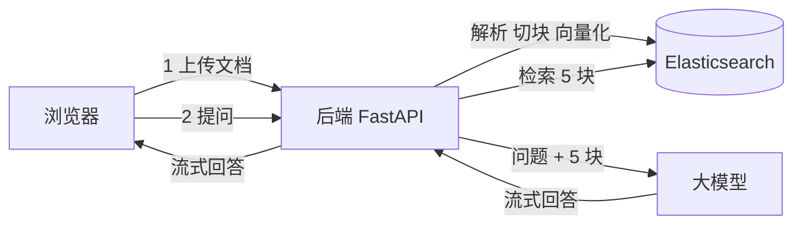
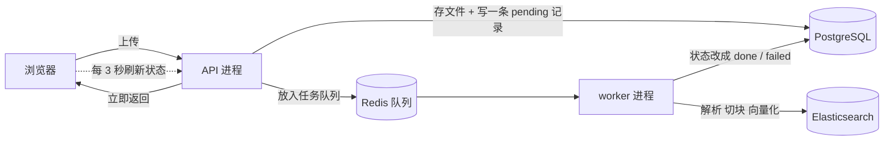

# RAG 系统导读

> 这篇只讲“全貌”和“去哪看代码”，10 分钟读完。文中的函数名链接可以直接点开，跳到代码对应的行。
>
> **四篇文档的推荐阅读顺序：**
>
> 1. [入门篇](./RAG入门篇.md)：RAG 是什么、术语表、关键设计的“为什么”。**RAG 新手先读这篇。**
> 2. 导读（本篇）：系统全貌、两条主线、去哪看代码。
> 3. [代码走读](./RAG系统核心模块深入篇.md)：跟着一次上传、一次提问，逐步看代码和实测数据。
> 4. [实战篇](./RAG实战篇.md)：回答不对时怎么定位问题、怎么衡量效果、下一步学什么。

---

## 一、这个系统做什么

用户上传文档（PDF、Word、Excel 等），然后用自然语言提问。系统从文档里找出相关段落，交给大模型，生成一段**带引用编号**的回答，边生成边推给浏览器。

整个系统只有两条主线：

1. **上传文档**：把文档切成小段（叫“块”），每块转成向量，存进 Elasticsearch。
2. **提问回答**：从 Elasticsearch 里找出最相关的 5 块，拼进提示词，让大模型回答。

其他功能（登录、会话历史、语音输入、推荐问题）都是围绕这两条主线的配套。



后端的“解析 + 检索”引擎（`backend/app/engine/`）是从开源项目 [RAGFlow](https://github.com/infiniflow/ragflow) 裁剪来的；接口、对话、会话管理是本项目自己写的。

---

## 二、主线一：上传文档

上传分成两段：**接口只负责收文件，解析在后台做。** 这样一份大 PDF 解析十几秒，也不会让其他用户的请求排队。



| 步骤 | 做什么 | 代码 | 在哪个进程 |
|---|---|---|---|
| 1 | 清洗文件名、检查类型和大小，保存文件，写一条“排队中”的记录，放入队列 | [`upload_files()`](../backend/app/api/chat.py#L146) → [`create_document()`](../backend/app/services/documents.py#L54) | API |
| 2 | 从队列取出任务，状态改成“解析中” | [`ingest_document()`](../backend/app/services/ingestion.py#L102) | worker |
| 3 | 按扩展名选解析器，读出文字和表格 | [`chunk()`](../backend/app/engine/rag/app/naive.py#L193) | worker |
| 4 | 把文字段落合并成约 128 token 的块，并分词 | [`naive_merge()`](../backend/app/engine/rag/nlp/__init__.py#L86)、[`tokenize()`](../backend/app/engine/rag/nlp/__init__.py#L188) | worker |
| 5 | 调阿里云百炼，把每块转成 1024 维向量 | [`generate_embedding()`](../backend/app/engine/rag/nlp/model.py#L103) | worker |
| 6 | 组装成 ES 文档（带页码、坐标），批量写入 | [`build_es_documents()`](../backend/app/services/ingestion.py#L82) → [`ESConnection.insert()`](../backend/app/engine/rag/utils/es_conn.py#L161) | worker |
| 7 | 状态改成“已完成”，记下切片数；失败则改成“异常”并记下原因 | [`_set_status()`](../backend/app/services/ingestion.py#L26) | worker |

前端知识库页会显示每个文档的状态和切片数，还有文档在排队或解析时，每 3 秒自动刷新一次。

**所有用户共用一个 ES 索引 `swxy_chunks`，靠每块上的 `kb_id` 字段区分是谁的。** 检索时只在当前用户的 `kb_id` 里找（[`retrieve_content()`](../backend/app/services/retrieval.py#L13)）。

---

## 三、主线二：提问回答

用户在聊天框输入问题后：

| 步骤 | 做什么 | 代码 |
|---|---|---|
| 1 | 接收问题，检查会话是否属于当前用户 | [`chat_on_docs()`](../backend/app/api/chat.py#L109) → [`get_owned_session()`](../backend/app/services/session.py#L26) |
| 2 | 取最近 5 轮对话，把追问改写成能单独检索的问题（“那它呢” → “青松科技的净利率是多少”） | [`rewrite_question()`](../backend/app/services/conversation.py#L44) |
| 3 | 检索入口：在会话的检索范围内（默认全部文档）找 5 条结果 | [`retrieve_content()`](../backend/app/services/retrieval.py#L13) |
| 4 | 问题 → 关键词检索语句 | [`FulltextQueryer.question()`](../backend/app/engine/rag/nlp/query.py#L70) |
| 5 | 问题 → 向量 | [`Dealer.get_vector()`](../backend/app/engine/rag/nlp/search_v2.py#L59) |
| 6 | 关键词 + 向量一起查 ES，取 128 条候选 | [`Dealer.search()`](../backend/app/engine/rag/nlp/search_v2.py#L80) |
| 7 | 调重排模型给候选打分，取前 5 | [`Dealer.rerank_by_model()`](../backend/app/engine/rag/nlp/search_v2.py#L281) |
| 8 | 拼提示词（带上历史对话），调大模型，流式返回；推荐问题同时生成 | [`stream_chat()`](../backend/app/services/chat.py#L95) |
| 9 | 前端逐行读流，拼出回答 | [`chat/index.tsx` 第 170 行](../frontend/src/pages/chat/index.tsx#L170) |
| 10 | 把回答里的 `##0$$` 渲染成可点的引用角标 | [`result.tsx` 第 43 行](../frontend/src/pages/chat/component/result.tsx#L43) |

步骤 4～7 都在 [`Dealer.retrieval()`](../backend/app/engine/rag/nlp/search_v2.py#L310) 里，是检索的总控函数。

**检索范围**是会话级的：输入框左下角的“全部文档”按钮可以勾选只在哪几份文档里找，选择保存在服务器上（`sessions.doc_ids`），刷新页面后仍然有效。选中的文档删光了也不会悄悄扩大到全部文档。

---

## 四、三个存储，各管一件事

| 存储 | 存什么 | 谁在写 |
|---|---|---|
| **Elasticsearch** | 文档的每一块：原文、分词、向量、页码 | worker 的 [`ingestion.py`](../backend/app/services/ingestion.py) |
| **PostgreSQL** | 用户、会话、每轮问答、文档清单和解析状态 | 各个 `services/` 模块，统一通过 ORM（`models/`） |
| **Redis** | ① 入库任务队列；② 会话里临时上传的小文档全文，2 小时过期 | [`tasks.py`](../backend/app/services/tasks.py)、[`quick_parse.py`](../backend/app/services/quick_parse.py) |

PostgreSQL **不存**文档内容，只存清单；文档内容只在 ES 里，原始文件在 Docker 数据卷 `file_data`（容器内的 `/data/files`）。

表结构以 [`alembic/versions/`](../backend/app/alembic/versions/) 里的迁移为准，API 容器每次启动都会自动执行（[`db/migrate.py`](../backend/app/db/migrate.py)）。

---

## 五、配置都在一个地方

所有配置项都定义在 [`core/config.py`](../backend/app/core/config.py#L10)，值从 `backend/.env` 读取，启动时统一校验：必填项缺失或格式不对，后端直接拒绝启动。`.env` 的模板见 [`backend/.env.example`](../backend/.env.example)。

其中三套模型密钥不能混用：

| 用途 | 环境变量 |
|---|---|
| 对话、推荐问题、会话起名 | `DASHSCOPE_API_KEY`、`DASHSCOPE_BASE_URL`（中转站）、`CHAT_MODEL` |
| 向量化、重排 | `EMBEDDING_API_KEY`（阿里云百炼北京） |
| 语音识别 | `ASR_API_KEY`、`ASR_BASE_URL` |

检索参数（块大小、返回几块、权重、阈值）和多轮对话参数（带几轮历史 `CHAT_HISTORY_TURNS`、改写追问用的模型 `REWRITE_MODEL`）也都在这里，改 `.env` 后重启即可，不用改代码。常用配置项的列表见 [backend/README.md](../backend/README.md#常用配置)。

---

## 六、目录速览

只列需要关心的文件，按阅读顺序排：

```
backend/app/
├── core/config.py               ⓪ 所有配置项
├── api/chat.py                  ① 核心接口：上传、提问、会话
├── services/
│   ├── documents.py             ② 上传：校验、存文件、入队
│   ├── ingestion.py             ③ 后台入库：解析 → 切块 → 向量化 → 写 ES
│   ├── conversation.py             多轮对话：整理历史、改写追问
│   ├── retrieval.py             ⑥ 检索的入口（很薄，只是调 Dealer）
│   ├── chat.py                  ⑨ 拼提示词、调大模型、流式返回
│   ├── llm.py                      对话大模型客户端
│   ├── session.py                  会话归属校验、检索范围、消息读写
│   ├── storage.py                  文件名清洗、文件存取
│   ├── tasks.py                    任务队列
│   └── quick_parse.py              会话临时文档（小文件直接塞进提示词）
├── engine/rag/
│   ├── app/naive.py             ④ 按文件类型选解析器 + 切块
│   ├── nlp/__init__.py          ⑤ 切块、分词的工具函数
│   ├── nlp/search_v2.py         ⑦ 检索核心：查 ES + 重排
│   ├── nlp/query.py                问题 → 关键词检索语句
│   ├── nlp/rag_tokenizer.py        中文分词器
│   ├── nlp/model.py             ⑧ 调向量模型、重排模型
│   └── utils/es_conn.py            ES 读写封装，按 mapping.json 建索引
├── models/                         ORM 模型，和数据库表一一对应
├── alembic/versions/               数据库迁移
├── worker.py                       后台入库进程的入口
└── manage.py                       运维命令：重新入库、迁移旧数据

frontend/src/pages/
├── chat/index.tsx               ⑩ 聊天页：发问题、读流
├── chat/component/result.tsx       渲染回答和引用角标
└── repository/index.tsx            知识库页：上传、状态和进度、重新解析、删除

frontend/src/components/sender/
└── scope.tsx                       输入框里的检索范围选择
```

按 ⓪～⑩ 的顺序读，就是把两条主线从头走一遍。

---

## 七、已修复的问题和仍需注意的地方

**这次已经修复的：**

| 问题 | 修复方式 |
|---|---|
| ES 把中文拆成单字 | 写入前按 `mapping.json` 建索引（[`ensure_index()`](../backend/app/engine/rag/utils/es_conn.py#L56)） |
| 向量检索被关键词过滤卡住 | kNN 只带结构化过滤条件（[`es_conn.py` 第 240 行](../backend/app/engine/rag/utils/es_conn.py#L240)） |
| 页码没有入库，标题混进存储路径 | 入库时带上切块算好的字段，文件名不再带路径 |
| 引用编号错位一位 | 提示词从 `[0]` 编号，返回给前端的参考列表和提示词一一对应 |
| 上传要等解析完才返回，期间所有请求排队 | 解析交给 worker 进程；接口改成普通 `def`，在线程池里执行；API 开 2 个进程 |
| 别人能读我的对话 | 所有按会话访问的接口都检查归属，不属于自己一律 404 |
| 文件名可能被用来写到存储目录之外 | 磁盘路径只由文档 ID 决定，文件名清洗后只用于展示 |
| 配置分散、密码写死在代码里 | 集中到 `core/config.py`，PostgreSQL 和 ES 的密码已更换 |
| 建表有 init.sql 和 Alembic 两套来源 | 只保留 Alembic；业务代码不再写原生 SQL |
| 失败时没有任何提示 | 解析失败在知识库页显示原因；重排、检索失败写告警日志；回答出错前端显示错误样式 |
| 只支持单轮问答 | 检索前结合最近 5 轮对话改写问题；生成时带上历史对话 |
| 文档没有状态 | 知识库页显示排队中 / 解析中（带进度百分比和当前阶段）/ 已完成 / 异常；失败或已完成的文档可以重新解析 |
| 不能限定检索范围 | 每个会话可以选只在哪几份文档里检索 |

**仍需注意的：**

1. **追问会多一次大模型调用。** 有历史的提问要先改写问题，实测每次 2～6 秒，回答的第一个字会晚这么久出现。可以在 `.env` 里设 `REWRITE_MODEL` 换一个更快的小模型专门做改写；改写偶尔会带入前文的条件（比如年份），回答上方会显示“按……检索”，用户能看到实际检索的问题。
2. **前端开发服务器默认监听所有网卡。** 它会把接口转发给后端。只通过 Tailscale 或本机访问时，启动前设置 `DEV_HOST=<Tailscale IP>`。
3. **重排失败时排序会退化。** 现在会写告警日志 `重排失败`，但不会在页面上提示。

---

## 八、怎么跑起来

在 `swxy/` 目录下执行：

```bash
# 后端：PostgreSQL、Elasticsearch、Redis、API、worker 五个容器
cp backend/.env.example backend/.env   # 第一次部署时，填好里面的必填项
(cd backend && docker compose up -d --build)

# 前端
(cd frontend && npm install && npm run dev)
```

打开 `https://localhost:5181/`。后端接口只监听本机，接口文档在 `http://localhost:8000/docs`，健康检查是 `/healthz`（进程是否活着）和 `/readyz`（数据库、ES、Redis 是否都可用）。

常用运维命令（在 `backend/` 目录下）：

```bash
docker compose ps                                        # 各服务状态
docker compose logs -f swxy_worker                       # 看解析进度和报错
docker exec -w /app swxy_api python manage.py reindex-all  # 改了切块或分词参数后，所有文档重新入库
```
