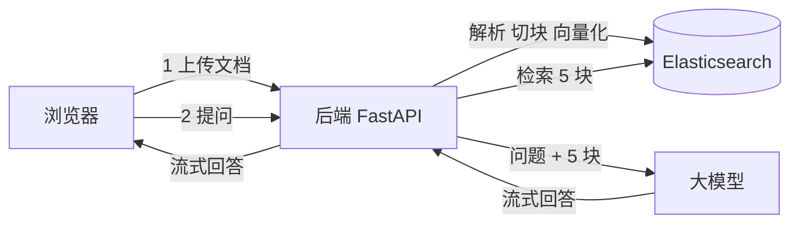

# RAG 系统导读

> 这篇只讲“全貌”和“去哪看代码”，10 分钟读完。文中的函数名链接可以直接点开，跳到代码对应的行。
>
> **四篇文档的推荐阅读顺序：**
>
> 1. [入门篇](./RAG入门篇.md)：RAG 是什么、术语表、关键设计的“为什么”。**RAG 新手先读这篇。**
> 2. 导读（本篇）：系统全貌、两条主线、去哪看代码。
> 3. [代码走读](./RAG系统核心模块深入篇.md)：跟着一次上传、一次提问，逐步看代码和实测数据。
> 4. [实战篇](./RAG实战篇.md)：回答不对时怎么定位问题、怎么衡量效果、下一步学什么。

---

## 一、这个系统做什么

用户上传文档（PDF、Word、Excel 等），然后用自然语言提问。系统从文档里找出相关段落，交给大模型，生成一段**带引用编号**的回答，边生成边推给浏览器。

整个系统只有两条主线：

1. **上传文档**：把文档切成小段（叫“块”），每块转成向量，存进 Elasticsearch。
2. **提问回答**：从 Elasticsearch 里找出最相关的 5 块，拼进提示词，让大模型回答。

其他功能（登录、会话历史、语音输入、推荐问题）都是围绕这两条主线的配套。



后端的“解析 + 检索”引擎（`backend/app/engine/`）是从开源项目 [RAGFlow](https://github.com/infiniflow/ragflow) 裁剪来的；接口、对话、会话管理是本项目自己写的。

---

## 二、主线一：上传文档

用户在“知识库”页面选文件上传后，代码按下面的顺序执行：

| 步骤 | 做什么 | 代码 |
|---|---|---|
| 1 | 接收文件，存到磁盘 | [`upload_files()`](../backend/app/api/chat.py#L203) |
| 2 | 按扩展名选解析器，读出文字和表格 | [`chunk()`](../backend/app/engine/rag/app/naive.py#L193) |
| 3 | 把文字段落合并成约 128 token 的块 | [`naive_merge()`](../backend/app/engine/rag/nlp/__init__.py#L86) |
| 4 | 对每块分词，生成检索用的字段 | [`tokenize()`](../backend/app/engine/rag/nlp/__init__.py#L188) |
| 5 | 调阿里云百炼，把每块转成 1024 维向量 | [`generate_embedding()`](../backend/app/engine/rag/nlp/model.py#L112) |
| 6 | 组装成 ES 文档，批量写入 | [`process_items()`](../backend/app/services/parsing.py#L33) → [`ESConnection.insert()`](../backend/app/engine/rag/utils/es_conn.py#L136) |
| 7 | 在 PostgreSQL 记一笔“该用户上传过这个文件” | [`insert_knowledgebase()`](../backend/app/services/knowledgebase.py#L6) |

步骤 2～6 由 [`execute_insert_process()`](../backend/app/services/parsing.py#L90) 串起来，是整条主线的总控函数。

**记住一点：每个用户一个 ES 索引，索引名就是用户 ID。** 见 [chat.py 第 216 行](../backend/app/api/chat.py#L216)：前端上传时不传 `session_id`，后端就用 `user_id` 代替，然后拿它当索引名。

---

## 三、主线二：提问回答

用户在聊天框输入问题后：

| 步骤 | 做什么 | 代码 |
|---|---|---|
| 1 | 接收问题 | [`chat_on_docs()`](../backend/app/api/chat.py#L160) |
| 2 | 检索入口，要 5 条结果 | [`retrieve_content()`](../backend/app/services/retrieval.py#L13) |
| 3 | 问题 → 关键词检索语句 | [`FulltextQueryer.question()`](../backend/app/engine/rag/nlp/query.py#L70) |
| 4 | 问题 → 向量 | [`Dealer.get_vector()`](../backend/app/engine/rag/nlp/search_v2.py#L46) |
| 5 | 关键词 + 向量一起查 ES，取 128 条候选 | [`Dealer.search()`](../backend/app/engine/rag/nlp/search_v2.py#L67) |
| 6 | 调重排模型给候选打分，取前 5 | [`Dealer.rerank_by_model()`](../backend/app/engine/rag/nlp/search_v2.py#L268) |
| 7 | 拼提示词，调大模型，流式返回 | [`get_chat_completion()`](../backend/app/services/chat.py#L280) |
| 8 | 前端逐行读流，拼出回答 | [`chat/index.tsx` 第 166 行](../frontend/src/pages/chat/index.tsx#L166) |
| 9 | 把回答里的 `##1$$` 渲染成可点的引用角标 | [`result.tsx` 第 43 行](../frontend/src/pages/chat/component/result.tsx#L43) |

步骤 3～6 都在 [`Dealer.retrieval()`](../backend/app/engine/rag/nlp/search_v2.py#L297) 里，是检索的总控函数。

---

## 四、三个存储，各管一件事

| 存储 | 存什么 | 谁在写 |
|---|---|---|
| **Elasticsearch** | 文档的每一块：原文、分词、向量 | [`parsing.py`](../backend/app/services/parsing.py) |
| **PostgreSQL** | 用户、会话、每轮问答、“谁上传了哪些文件” | [`chat.py` 的 `write_chat_to_db()`](../backend/app/services/chat.py#L192) 等 |
| **Redis** | 会话里临时上传的小文档全文，2 小时过期 | [`quick_parse.py`](../backend/app/services/quick_parse.py#L171) |

PostgreSQL **不存**文档内容，只存清单；文档内容只在 ES 里。

---

## 五、三套模型密钥，不能混用

都在 `backend/.env` 里配置：

| 用途 | 环境变量 | 调用位置 |
|---|---|---|
| 对话、推荐问题、会话起名 | `DASHSCOPE_API_KEY`、`DASHSCOPE_BASE_URL`（中转站） | [`services/chat.py`](../backend/app/services/chat.py#L348) |
| 向量化、重排 | `EMBEDDING_API_KEY`（阿里云百炼北京） | [`nlp/model.py`](../backend/app/engine/rag/nlp/model.py#L100) |
| 语音识别 | `ASR_API_KEY`、`ASR_BASE_URL` | [`api/asr.py`](../backend/app/api/asr.py#L78) |

对话模型名 `gpt-6.1-sol` 写死在代码里，换模型要改 `services/chat.py`。

---

## 六、目录速览

只列需要关心的文件，按阅读顺序排：

```
backend/app/
├── api/chat.py                  ① 所有核心接口的入口（上传、提问、会话）
├── services/
│   ├── parsing.py               ② 上传主线的总控
│   ├── retrieval.py             ⑤ 检索的入口（很薄，只是调 Dealer）
│   ├── chat.py                  ⑧ 拼提示词、调大模型、流式返回
│   └── quick_parse.py              会话临时文档（小文件直接塞进提示词）
└── engine/rag/
    ├── app/naive.py             ③ 按文件类型选解析器 + 切块
    ├── nlp/__init__.py          ④ 切块、分词的工具函数
    ├── nlp/search_v2.py         ⑥ 检索核心：查 ES + 重排
    ├── nlp/query.py                问题 → 关键词检索语句
    ├── nlp/rag_tokenizer.py        中文分词器
    ├── nlp/model.py             ⑦ 调向量模型、重排模型
    └── utils/es_conn.py            ES 读写封装

frontend/src/pages/chat/
├── index.tsx                    ⑨ 聊天页：发问题、读流
└── component/result.tsx            渲染回答和引用角标
```

按 ①～⑨ 的顺序读，就是把两条主线从头走一遍。

---

## 七、已知问题（改代码前先看）

读代码和实测时发现的问题。每条的详细分析和代码位置在代码走读里。

1. **引用编号错位一位。** 提示词从 `[1]` 编号，前端却按 0 开始取，点开的是下一条引用。→ [走读 2.9](./RAG系统核心模块深入篇.md#29-前端渲染引用角标)
2. **ES 把中文拆成了单字。** 索引没按设计的映射创建，代码分好的词进了 ES 又被拆开，关键词检索变弱。→ [走读 2.4](./RAG系统核心模块深入篇.md#24-关键词和向量一起查-es)
3. **向量检索被关键词“卡住”。** 关键词条件也被放进了向量检索的过滤器，用词不同时向量检索补不回来。→ [走读 2.4](./RAG系统核心模块深入篇.md#24-关键词和向量一起查-es)
4. **页码没有入库。** 引用卡片上的页码永远是 `-`。→ [走读 1.6](./RAG系统核心模块深入篇.md#16-组装成-es-文档并写入)
5. **重排失败时没有任何提示。** 会悄悄退化成只按关键词排序，容易混进别的文档。→ [走读 2.5](./RAG系统核心模块深入篇.md#25-重排给候选重新打分)
6. **只支持单轮问答。** 提示词里不带历史对话，追问“那它呢”模型不知道“它”是谁。→ [走读 2.6](./RAG系统核心模块深入篇.md#26-拼提示词)
7. **任何人都能读别人的对话。** [`/get_messages`](../backend/app/api/history.py#L95) 不检查会话是否属于当前用户。
8. **`.env.example` 里像是有一个真实的向量服务密钥。** 示例文件不该放真实密钥。

---

## 八、怎么跑起来

在 `swxy/` 目录下执行：

```bash
# 后端（Elasticsearch、PostgreSQL、Redis、API 四个容器）
(cd backend && docker compose up -d --build)

# 前端
(cd frontend && npm install && npm run dev)
```

打开 `https://localhost:5181/`。接口文档在 `http://localhost:8000/docs`。
